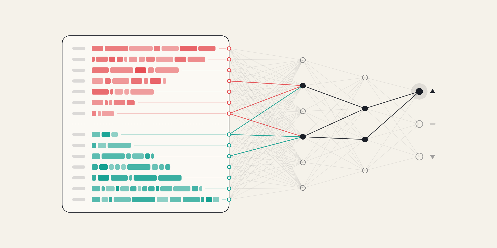

# Learning ML with L3 data

Trying to better understand how to implement and think about machine learning in code, using L3 (order-by-order) market data :)



## What's here

- `logistic_regression.ipynb`: first prediction model I am working on (first draft now done)
- `scripts/extract_itch.py`: turns Nasdaq's raw order feed into message and order book tables.

## Getting the data

The data isn't in the repo. Download one day of Nasdaq's free ITCH sample (3.5 GB) and extract it:

```bash
mkdir -p data
curl -L -o data/12302019.NASDAQ_ITCH50.gz "https://emi.nasdaq.com/ITCH/Nasdaq%20ITCH/12302019.NASDAQ_ITCH50.gz"
python scripts/extract_itch.py data/12302019.NASDAQ_ITCH50.gz
```

Needs Python 3 with numpy, pandas and pyarrow.
